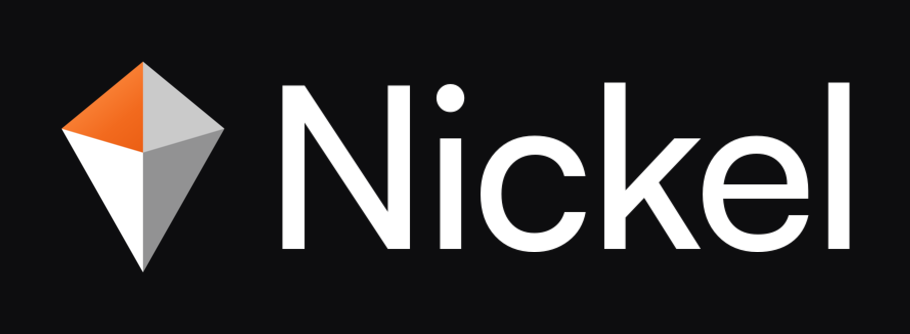
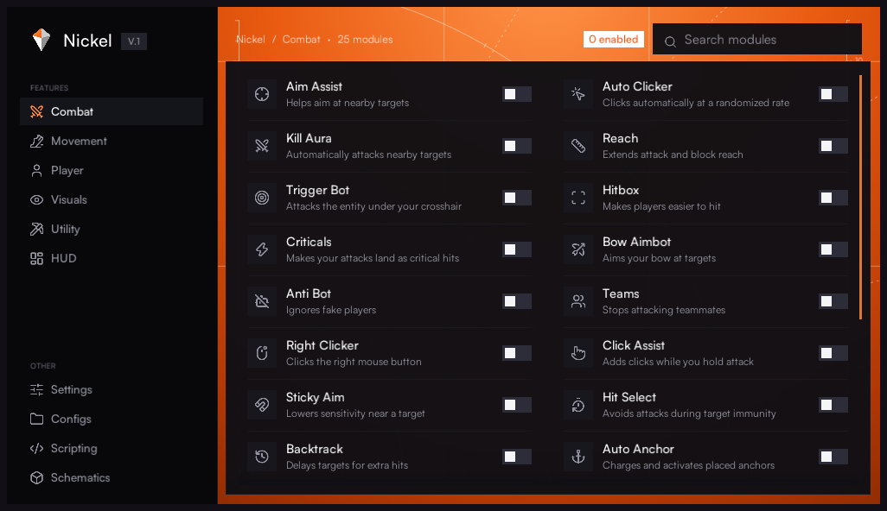
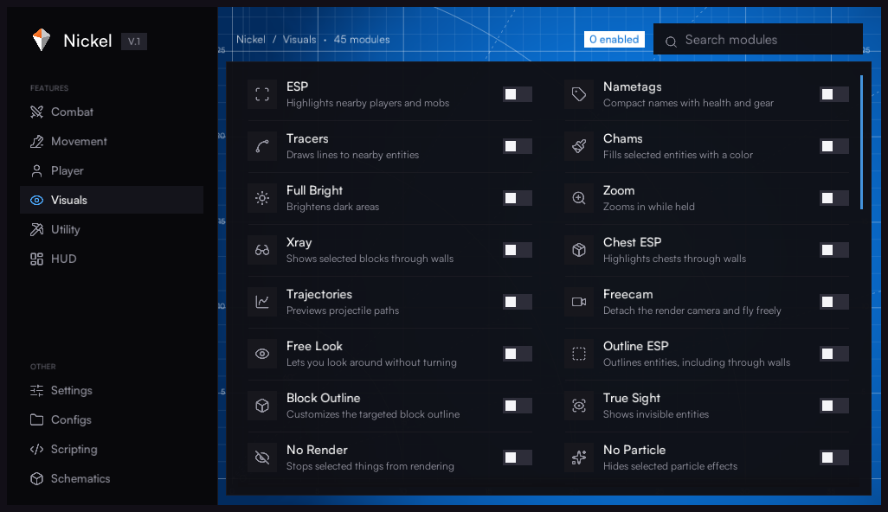
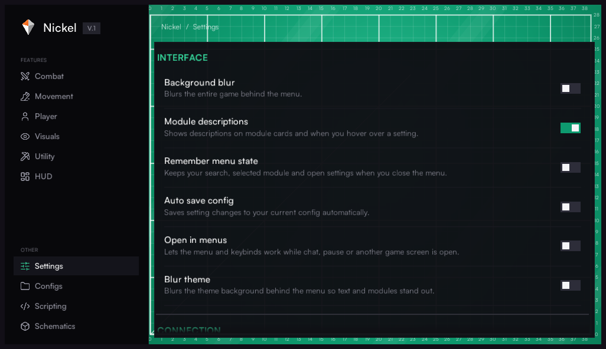
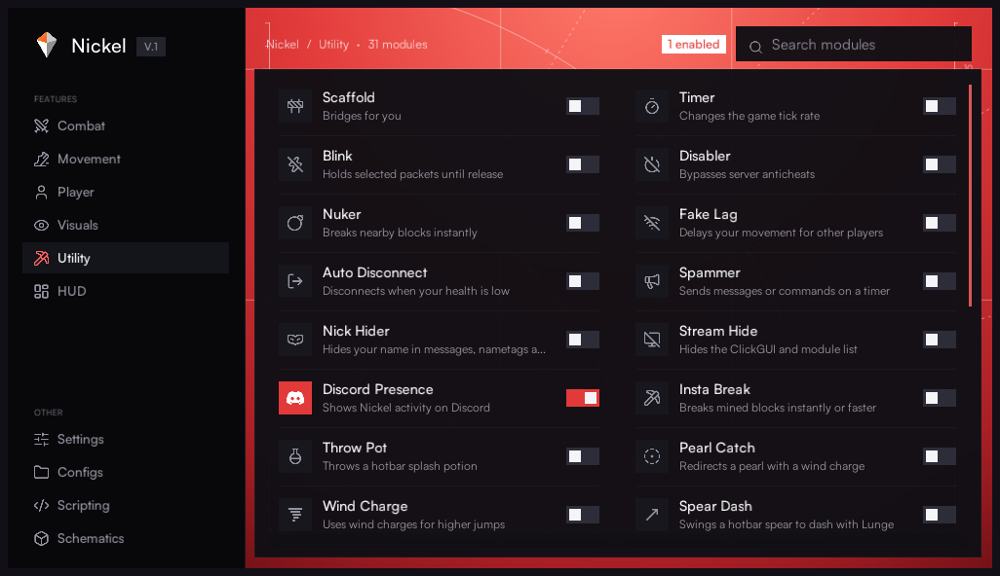
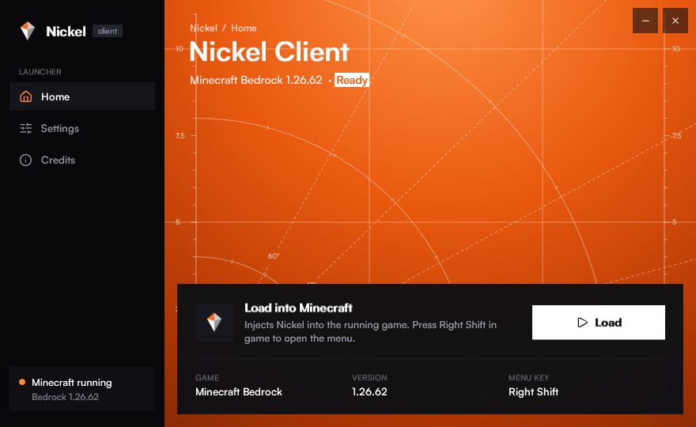

<p align="center"></p>

# Nickel

> An independent, unofficial client for Minecraft: Bedrock Edition on Windows. Not approved by
> or associated with Mojang or Microsoft. Minecraft is a trademark of Microsoft Corporation.

> [!WARNING]
> Nickel loads into the official game and changes how it behaves. Servers and their anticheats
> may flag you, and some servers will ban you. Several Combat and Movement modules are still in
> progress. Play in your own worlds, or on servers that allow it, at your own risk.

A launcher and an in-game menu for Minecraft: Bedrock Edition. Press Right Shift in game for
150 modules, 26 HUD elements you lay out yourself, Luau scripting, schematics and configs, all under one
animated look with six themes.

[](https://nickelclient.com/download)
[](https://nickelclient.com)
[](https://github.com/crossthepath/nickel-client/releases/latest)
[](https://discord.gg/pn2FdFhY9j)



| | |
| --- | --- |
|  |  |
|  |  |

## Download

Download **`Nickel.exe`** from [nickelclient.com](https://nickelclient.com/download) or from the
[latest release](https://github.com/crossthepath/nickel-client/releases/latest). It is one file, with nothing to install:

1. Open Minecraft: Bedrock Edition.
2. Start `Nickel.exe` and press **Load**.
3. Press **Right Shift** in a world to open the menu.

The launcher updates itself: **Settings → Check for updates** downloads the newest version and asks you to restart
it. Your settings, configs, scripts and schematics stay in `%APPDATA%\Nickel`.

Nickel targets Minecraft: Bedrock Edition **1.26.62** for Windows 10 and 11 (x64). No Mojang
assets are shipped. The [documentation](https://nickelclient.com/docs/) covers every screen and module.

You only need the next section to change Nickel or build it yourself.

## Build and run

To build from source, you need Visual Studio 2022 with the C++ workload, CMake 3.20+, the .NET 8 SDK and Python 3.

```sh
git clone --recursive https://github.com/crossthepath/nickel-client.git
cd nickel-client
powershell -ExecutionPolicy Bypass -File tools/build_desktop.ps1 -OutputFolder dist/Nickel
```

This builds the native overlay, bundles it into the launcher and writes `dist/Nickel/Nickel.exe`.
Open Minecraft, start `Nickel.exe`, press **Load**, then **Right Shift** in a world.

To load from a script instead of the launcher window:

```sh
dist/Nickel/Nickel.exe --load-pid <Minecraft PID>
```

## What's inside

| Feature | What it does |
| --- | --- |
| **Combat** | 25 modules: Aim Assist, Kill Aura, Reach, Criticals, Anti Bot, Teams… |
| **Movement** | 33 modules: Flight, Step, Spider, Bunny Hop, Velocity, Strafe… |
| **Player** | 18 modules: Auto Armor, Auto Totem, Auto Respawn, Fast Use, Anti AFK… |
| **Visuals** | 45 modules: ESP, Chams, Nametags, Xray, Block and Chest ESP, Freecam, Item Physics, Custom Sky… |
| **Utility** | 29 modules: Scaffold, Nuker, Bed Breaker, Air Place, Base Finder, Timer, Blink… |
| **HUD** | 26 elements: keystrokes, CPS, armor, target, module list, minimap, Spotify… placed with the layout editor. |
| **Scripting** | Your own modules, settings, commands and events in [Luau](https://luau.org), loaded from `%APPDATA%\Nickel\scripts` and reloaded live. |
| **Schematics** | `.mcstructure`, Java `.nbt`, Sponge `.schem` and `.litematic`: textured ghost blocks, material list, block info and auto place. |
| **Configs** | Save, load and bind full setups to a key. |
| **Themes** | Orange, Blueprint, Cutting Mat, Violet, Crimson and Graphite, each with its own animated background. |
| **Launcher** | Automatic load, close after loading, Stream Hide (launcher and menu kept out of recordings), start with Windows, menu key, updates. |

## Themes

| Theme | Background | Accent |
| --- | --- | --- |
| **Orange** | Technical drawing on an orange glow | `#FF8A3D` |
| **Blueprint** | Blue grid with arcs and angle rays | `#4DABFF` |
| **Cutting Mat** | Green cutting mat with sliding reflections | `#34D399` |
| **Violet** | Violet technical drawing | `#B47BFF` |
| **Crimson** | Red technical drawing | `#FF6363` |
| **Graphite** | Grey grid | `#EBEBF0` |

Pick one in **Settings → Theme**, in game or in the launcher. The look follows
[branding/nickel/README.md](branding/nickel/README.md).

## How it works

```text
Nickel.exe (WPF launcher)
   └─ loads ──▶ Nickel.Overlay.dll inside Minecraft.Windows.exe
                   ├─ DXGI hooks ──── Dear ImGui on DX11 / DX12: menu, HUD, world drawing
                   ├─ game hooks ──── ticks, packets, input, rendering (MinHook)
                   └─ Luau ────────── user scripts
```

The launcher checks that the game is the official build and that no other client is loaded,
then loads the overlay. The overlay uses the function addresses of the supported game version
(1.26.62) and checks their code before hooking anything.

Built on these libraries:

| Library | Used for |
| --- | --- |
| [Dear ImGui](https://github.com/ocornut/imgui) | Menu, HUD and world drawing inside the game. |
| [MinHook](https://github.com/TsudaKageyu/minhook) | Function hooks in the game. |
| [Luau](https://github.com/luau-lang/luau) | The scripting runtime. |
| [Satoshi](https://www.fontshare.com/fonts/satoshi) | The typeface, by Indian Type Foundry. |

Layout: `native/` (the overlay), `desktop/` (the launcher), `include/` and `src/` (shared rules),
`tests/`, `tools/` (build scripts), `ui/catalog.js` (module descriptions), `branding/` (logos and the brand guide).

## Contributing

Build with the renderer checks and run the tests before pushing:

```sh
cmake -S . -B build -DNICKEL_ENABLE_RENDERER_TESTS=ON
cmake --build build --config Release
ctest --test-dir build -C Release --output-on-failure
```

Read [AGENTS.md](AGENTS.md) for the repository rules and [docs/architecture](docs/architecture/overview.md) for how
the overlay is put together. Open an issue or a pull request; questions are welcome on
[Discord](https://discord.gg/pn2FdFhY9j).

## Community

Website and documentation: [nickelclient.com](https://nickelclient.com). Questions, bugs and ideas:
[Discord](https://discord.gg/pn2FdFhY9j).

## License

All rights reserved for now. Third-party code and assets keep their own licenses; see
[THIRD_PARTY_NOTICES.md](THIRD_PARTY_NOTICES.md).
